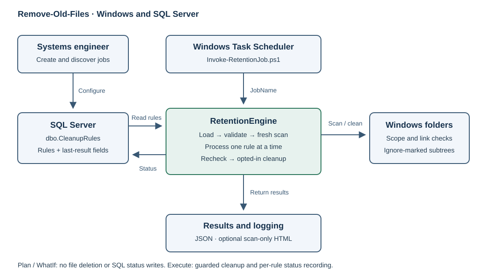

# Remove-Old-Files

Centralised SQL Server cleanup rules, executed sequentially by a Windows scheduled task. RetentionEngine plans by default; deletion requires Execute. Real rule attempts record UTC completion time, an exception flag and the actual machine name.

**Current version: 2.0.0-rc1.** Windows x64, PowerShell 7.4 or later and SQL Server. Integrated authentication is the default; SQL credentials are optional. The maintained SQL client and its dependencies are bundled for offline deployment.

## Start here

- [Implementation and operations guide](docs/implementation-guide.md): architecture, SQL setup, permissions, policies, reports, execution and scheduling.
- [Release readiness](docs/release-readiness.md): the final validation gates.
- [Verification evidence](docs/verification.md): checks actually performed and their limits.
- [Contributing](CONTRIBUTING.md): code style, tests, module packaging and dependency maintenance.



## Quick preview

From the repository or deployed runtime root:

```powershell
Import-Module ./src/RetentionEngine/RetentionEngine.psd1 -Force

Get-RetentionJob -ServerInstance SQL01 -Database Automation

Invoke-RetentionCleanup -ServerInstance SQL01 -Database Automation -JobName AppLogs -Execute -WhatIf
```

The root Invoke-RetentionJob.ps1 is the Task Scheduler entry point. Production needs that file and the complete src/RetentionEngine directory; tests and build/lab tools stay in the source repository. No task, database or table is created automatically.

The former single-script implementation and environment-specific CSV are available in Git history. Current CSV commands remain report-only migration helpers. See the guide for their supported format.
