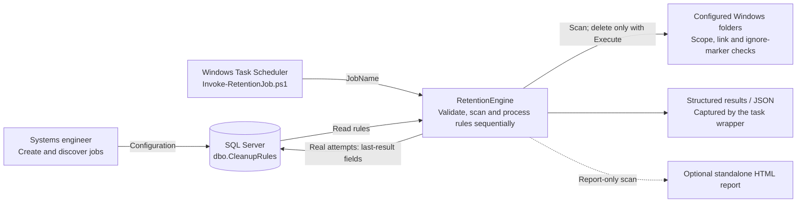

# Remove-Old-Files: implementation and operations

Remove-Old-Files centralises cleanup rules in SQL Server. A Windows scheduled task supplies a job name, the PowerShell module reads that job's enabled rules, and it processes them one at a time. Each real attempt records when the rule ran, whether it encountered an exception and which machine executed it.

This is the implementation guide for **RetentionEngine 2.0.0-rc1**. The scope is Windows x64, PowerShell 7.4 or later, SQL Server and one configuration table. The systems engineer chooses the machine and schedule. There is no machine registry, work claiming, parallel worker engine or automatic task deployment.

## Architecture



[A standalone SVG version is available here](architecture.svg). Plan and WhatIf runs read configuration and inspect files but do not delete files or update SQL status. HTML export is a separate, explicit command.

## Repository and deployment layout

| Path | Purpose |
| --- | --- |
| Invoke-RetentionJob.ps1 | Scheduled-task entry point; imports the module and returns process exit codes |
| src/RetentionEngine/ | Complete runtime module, private helpers and bundled SQL dependencies |
| database/sqlserver/001_cleanup_rules.sql | One-time table deployment script |
| docs/ | This guide, release gates, architecture diagram and verification evidence |
| tools/ | Lab generation, acceptance checks, packaging and dependency-maintenance tools |
| tests/ | Pester behaviour, safety, SQL orchestration and package checks |

The repository keeps tests and dependency-rebuild inputs because they are needed to verify and maintain the solution. They are not production runtime dependencies. Generated packages, test output, SDK bin/obj directories and editor files are ignored by Git. The former standalone script, its sample CSV and obsolete milestone documents have been removed from the current tree; their history remains in Git.

For a scheduled-task deployment, copy this runtime layout to the Windows host:

```text
C:\Automation\Remove-Old-Files\
    Invoke-RetentionJob.ps1
    src\RetentionEngine\
        RetentionEngine.psd1
        RetentionEngine.psm1
        Public\
        Private\
        lib\
    LICENSE
```

Keep the whole module directory together. Its lib/ directory contains Microsoft.Data.SqlClient 6.1.7 LTS, transitive dependencies, licences and a checksum inventory. These files are not unused simply because a basic SQL login does not exercise every provider feature. No SqlServer PowerShell module, .NET SDK, Pester installation or internet package restore is required on the execution host. PowerShell itself must already be installed.

The database script and this guide may be retained with the deployment kit for administration. The execution host does not need tools/, tests/ or dependency build intermediates.

## 1. Prepare SQL Server

Use an existing automation database. The module does not create a database, login, user or table automatically. Deploy database/sqlserver/001_cleanup_rules.sql manually through the normal database administration process, in a session with no open transaction.

The script refuses any existing schema object named dbo.CleanupRules. It creates the table and job-name index in one transaction, explicitly rolls back caught creation errors and rethrows the original error. It is a deployment script, not a declarative SQL-project table definition. A repeat execution deliberately fails rather than altering existing configuration.

| Column | Meaning |
| --- | --- |
| RuleId | SQL-generated unique rule identifier |
| JobName | Logical name supplied by the configured task; several rows can share it |
| CleanupPath | Absolute directory on the execution machine, or a UNC directory it can access |
| FileExtension | Bare extension such as log or tar.gz; explicitly empty means all files |
| RetentionDays | Integer from 1 to 36500 |
| IncludeSubfolders | Recursion bit; default false |
| Enabled | Whether the rule participates in the job; default true |
| LastExecutedAtUtc | UTC completion time of the most recent real attempt |
| LastHadExceptions | Whether that attempt encountered a scan/removal or unexpected execution exception |
| LastMachineName | Machine on which that attempt ran; never a routing restriction |

The three last-result fields begin NULL, meaning not yet executed. They are per-rule summaries, not a run-history database. Detailed results belong in the returned object and captured logs.

The runtime account needs SELECT access and UPDATE permission on the three last-result columns. An account creating policies also needs INSERT and SELECT access. For existing database roles, the DBA can grant permissions along these lines:

```sql
GRANT SELECT ON OBJECT::dbo.CleanupRules TO [CleanupRuntime];

GRANT UPDATE (LastExecutedAtUtc, LastHadExceptions, LastMachineName)
    ON OBJECT::dbo.CleanupRules TO [CleanupRuntime];

GRANT SELECT, INSERT ON OBJECT::dbo.CleanupRules TO [CleanupAdministrators];
```

Replace those role names with your existing principals. The deployment account needs the separate permissions required to create the table and index. These examples do not create users, roles or logins.

Connections request encryption and certificate validation. The SQL Server certificate must be trusted and match the connection name. Connection timeout is 15 seconds and command timeout is 30 seconds; there is no certificate-validation bypass parameter.

## 2. Connect and create a job's rules

Run PowerShell from the repository or deployed runtime root:

```powershell
Import-Module ./src/RetentionEngine/RetentionEngine.psd1 -Force

$connection =
@{
    ServerInstance = 'SQL01'
    Database       = 'Automation'
}

Get-RetentionJob @connection
```

Integrated authentication uses the current Windows account. For SQL authentication, obtain a PSCredential through your existing secret-handling process and pass Credential to the database commands. An interactive example is Get-Credential; the module does not store passwords or create a credential store.

Create a rule by name, previewing the insert first:

```powershell
$rule =
@{
    JobName           = 'AppLogs'
    CleanupPath       = 'D:\AppLogs'
    FileExtension     = 'log'
    RetentionDays     = 30
    IncludeSubfolders = $true
}

New-RetentionPolicy @connection @rule -WhatIf
$created = New-RetentionPolicy @connection @rule
$created | Select-Object RuleId, JobName, CleanupPath, Enabled
```

WhatIf validates the settings without contacting SQL Server. A real insert returns the generated RuleId and database values. Use Disabled to create a rule for later review. Creating a rule does not execute it or install a scheduled task.

A second insert creates another rule; it does not update the first one. Paths need not exist on the configuring machine. Agree on job-name spelling/case with the DBA because grouping follows the database collation. After an uncertain connection failure, inspect the table before retrying an insert.

Get-RetentionJob includes disabled-only job names by default. Use EnabledOnly to list names with active rules, or Select-Object -ExpandProperty JobName to obtain strings for task configuration.

## 3. Inspect the plan and optional HTML

```powershell
$plan = Invoke-RetentionCleanup @connection -JobName 'AppLogs'

$plan | Select-Object Mode, Status, EnabledRuleCount, PlannedCount, ErrorCount
$plan.Rules | Select-Object RuleId, Status, HadExceptions
```

The default mode is ReportOnly. The engine validates the complete enabled configuration before scanning. Invalid configuration, duplicate rule identifiers or equal/nested roots within a job stop it before any rule attempt. Overlapping roots are rejected even when their extensions differ. Disabled rules are not scanned or updated. An unknown job raises an error; a known job with no enabled rules returns Disabled.

Each rule gets a fresh scan. Files qualify when LastWriteTimeUtc is strictly earlier than the UTC cutoff. A timestamp exactly on the cutoff does not qualify. The scanner includes hidden files, skips links/reparse points and never selects directories for removal. A regular file named ignore protects its entire containing subtree. Filesystem roots, provider/device paths and parent-traversal segments are rejected. Local policies accept filename literals, * and ? without path separators or bracket expressions.

To create HTML, choose an existing output directory outside every cleanup root:

```powershell
$reports = 'C:\AutomationLogs\Cleanup'
$null = [IO.Directory]::CreateDirectory($reports)

foreach ($ruleResult in $plan.Rules)
{
    $path = Join-Path $reports ($ruleResult.RuleId.ToString() + '-before.html')

    Export-RetentionReportHtml -Report $ruleResult.ExecutionResult.ScanReport -LiteralPath $path
}
```

The report embeds its CSS and escapes data; it needs no external assets or JavaScript. Policy, candidate and exclusion details start collapsed, with counts visible in their headings. Errors expand automatically when present. Click a section heading or use the keyboard to expand it; print styling exposes all details. Routine age and filename-pattern skips are omitted from the HTML exclusion list to avoid thousands of irrelevant rows. Aggregate totals still include them, and the original structured scan result retains all observed exclusions. Protected directories, skipped links and other non-routine exclusions remain listed. Existing reports require Force to replace. WhatIf on the exporter creates no file. Inspect the report status and errors before treating an empty candidate list as a successful empty scan.

## 4. Preview and execute

```powershell
$preview = Invoke-RetentionCleanup @connection -JobName 'AppLogs' -Execute -WhatIf

$execution = Invoke-RetentionCleanup @connection -JobName 'AppLogs' -Execute -Confirm
$execution | Select-Object Mode, Status, ProcessedRuleCount, DeletedCount, ErrorCount
$execution.Rules | Select-Object RuleId, Status, HadExceptions, StatusRecorded, ErrorMessage
```

Execute is required for deletion. WhatIf prevents both deletion and SQL status updates. A preview does not prove that a later delete will be permitted. A real run checks effective status-update permissions before deleting anything, then processes enabled rules sequentially in RuleId order.

An incomplete scan blocks deletion for that rule. Before and after confirmation, each candidate is checked again for containment, ignore markers, links, type, timestamp and length. Changed or declined candidates are skipped. Hidden eligible logs can be removed; read-only files are explicitly refused. ACL and locked-file failures remain errors. No application retry bypasses those failures.

After every real rule attempt, the module records UTC completion, the exception bit and the actual host name. A clean zero-candidate attempt is still recorded and clears an earlier exception bit. Changed/declined candidates can make a result Partial without being exceptions. Plans, WhatIf runs, disabled rules and unattempted rules leave last-result fields unchanged. Configuration errors raise an error before attempts begin and do not rewrite previous status.

A scan/removal failure can be recorded and the next independent rule processed. If recording itself fails, the job stops before the next rule. Inspect StatusRecorded, Errors and UnattemptedRuleCount. File deletion and SQL updates are not one transaction: earlier deletions cannot be rolled back, and a lost connection can leave an uncertain database write.

Save the execution result separately:

```powershell
$receipt = Join-Path $reports 'AppLogs-execution.json'

$execution | ConvertTo-Json -Depth 16 | Set-Content -LiteralPath $receipt -Encoding utf8
```

HTML is for report-only scans. Execution scan snapshots are marked PreExecutionSnapshot and rejected by that exporter, preventing a post-deletion snapshot from being presented as a no-deletion receipt. Detailed execution evidence is the structured result/JSON.

The filesystem is not locked across inspection and deletion. The checks reduce ordinary operational surprises; they are not protection against hostile concurrent replacement. Restrict write access to cleanup scopes, avoid overlapping scheduled instances and stop a task before editing its rules.

## 5. Configure Windows Task Scheduler

Use the root Invoke-RetentionJob.ps1 entry point. It resolves the module relative to its own location and does not depend on the task's working directory. For example:

Program:

```text
C:\Program Files\PowerShell\7\pwsh.exe
```

Arguments:

```text
-NoProfile -NonInteractive -File "C:\Automation\Remove-Old-Files\Invoke-RetentionJob.ps1" -ServerInstance SQL01 -Database Automation -JobName AppLogs -Execute
```

Omit Execute for a plan. Combine Execute and WhatIf for a preview. The entry point suppresses confirmation by default for unattended runs; an explicitly requested Confirm enables prompts for interactive use. Configure the task not to start another instance while the same job is running. Machine assignment, replacement and duplicate-job prevention remain the SE's responsibility.

The task account needs SQL access, filesystem deletion rights and any required share permissions. Test using the actual scheduled logon settings; an interactive integrated login does not prove that the scheduled account can reach SQL or a UNC share.

| Process exit | Meaning |
| --- | --- |
| 0 | Completed or intentionally Disabled |
| 1 | Partial, Failed, Blocked or a terminating setup/database error |

The entry point writes a returned job as JSON to stdout; setup errors go to stderr. Task Scheduler does not retain those streams automatically. Capture them through the existing task wrapper, for example:

```powershell
$log = 'C:\AutomationLogs\Cleanup\AppLogs.log'

& 'C:\Program Files\PowerShell\7\pwsh.exe' -NoProfile -NonInteractive -File 'C:\Automation\Remove-Old-Files\Invoke-RetentionJob.ps1' -ServerInstance SQL01 -Database Automation -JobName AppLogs -Execute *> $log

exit $LASTEXITCODE
```

Create the log directory first and keep it outside cleanup scopes. An SE wrapper can load New-LogEntry and record the job/rule IDs, mode, status and errors alongside other automation logs. SingularVector's article **PowerShell Logging: New-LogEntry Revisited** explains the function's logging approach. This module does not import it automatically. The SQL last-result bit is a summary; it does not replace a useful log.

## Local policies and CSV migration

The module also accepts one typed local policy through Invoke-RetentionCleanup -Policy. Required fields are PolicyId, RootPath, FilePattern, RetentionDays, Recurse and Enabled; integer/Boolean fields must be actual integers/Booleans. Get-RetentionReport accepts the same policy and an optional fixed EvaluationTimeUtc for reproducible scans.

The CSV commands remain migration/reporting helpers and do not write SQL rules or delete files. They accept exactly these four headers:

| Header | Conversion |
| --- | --- |
| CleanupPath | Absolute policy root |
| FileExtension | Bare extension; empty explicitly means all files, with a warning |
| AgeTolerance | Integer days, 1–36500; empty defaults to 90, with a warning |
| IncludeSubFolders | 0/1; empty defaults to false, with a warning |

Import-RetentionPolicyCsv exposes Policies, Warnings, Errors and Overlaps. Get-RetentionBatchReport rejects malformed rows or overlapping roots before scanning. IsReady means configuration validation passed, not that paths exist or access is permitted. The lab generator below produces a correctly shaped CSV with current local paths; no environment-specific production CSV is committed.

## Validate in the VM before release

Start with a new directory:

```powershell
$lab = ./tools/New-RetentionTestData.ps1 -LiteralPath 'C:\RetentionLab01'

$report = Get-RetentionReport -Policy $lab.Policy -EvaluationTimeUtc $lab.EvaluationTimeUtc
$report | Select-Object Status, CandidateCount, ErrorCount
```

The lab has 14 synthetic files: four eligible main-scope logs, recent/current/future files, an old text file, protected subtrees and three isolated cutoff-boundary cases. Expected main result is Completed with four candidates and no errors. The main Execute exercise should delete those four logs, including the hidden log. Other files remain. The generator refuses existing directories and supports WhatIf.

Reload lab.clixml after reopening PowerShell. inventory.csv records timestamps and expected outcomes. Keep EvaluationTimeUtc fixed for the boundary policy: only before-cutoff.log qualifies. Real cleanup always uses the current time, so boundary-data is deliberately outside the main deletion scope. Generate a fresh default lab for live deletion tests; an old reference date can change live eligibility.

For real SQL acceptance, first deploy the table in a disposable database, then run:

```powershell
$acceptance =
@{
    ServerInstance = 'SQL01'
    Database       = 'AutomationLab'
    LiteralPath    = 'C:\RetentionRelease01'
}

./tools/Test-SqlServerRelease.ps1 @acceptance -Execute
```

The test creates two synthetic rules under a unique job name and leaves them and retained fixtures for inspection. It checks unchanged preview status, eight deletions including hidden logs, persisted UTC/machine/exception fields, a read-only-file failure and a later successful run clearing the exception bit. It does not create a database, login, table or scheduled task. Keep the returned JobName so the SE can remove that test configuration afterwards.

The stable release gate is documented in [release readiness](release-readiness.md); actual evidence and limits are in [verification](verification.md).

## Public command reference

| Command | Responsibility |
| --- | --- |
| Get-RetentionJob | Discover configured names and rule counts |
| New-RetentionPolicy | Insert one SQL rule with parameterised values and WhatIf support |
| Invoke-RetentionCleanup | Plan or execute a local policy or named SQL job |
| Get-RetentionReport | Read-only scan of one policy |
| Export-RetentionReportHtml | Export a report-only scan as standalone HTML |
| Import-RetentionPolicyCsv | Validate/convert the four-column CSV format |
| Get-RetentionBatchReport | Validate the whole CSV, then produce read-only policy reports |

Use Get-Help with Examples for the command interface. Build and code-maintenance instructions are in [CONTRIBUTING](../CONTRIBUTING.md).
